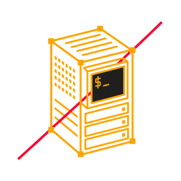

# Breachlab Ghost II Writeup

Hello! Here's my writeup on the Breachlab's Ghost II track. Ghost II carries that instinct up the CI/CD delivery pipeline, from initial access to the supply chain itself. I really learned a lot doing this lab and the whole Ghost track in general. It was my first time dealing with some of these problems (Git, Docker, Kubernetes, etc) and my terminology may not be correct on some parts, so I apologize in advance. Nevertheless, I hope you find this as interesting as I did!
